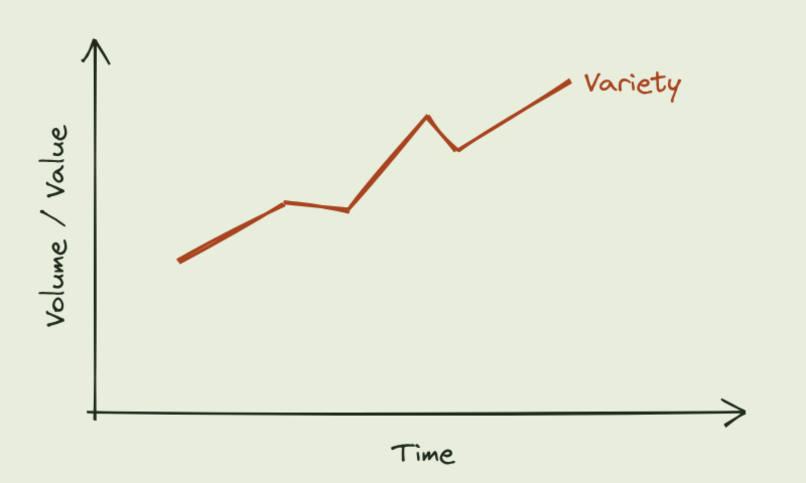

## Preface

At an early-stage startup, there are a dizzying number of choices to be made day to day: what to continue working on, what to pick up anew and what to drop. There are oceans of information flowing past, news releases, government policy changes and real and fabricated narratives of every imaginable species. To put it mildly, it is quite overwhelming.

And so many choices are made unintentionally, through inertia and the subconscious, unexpressed calculus of one or a few people, usually the decision makers of the organization. Regular discussions between teammates are often dominated by reports of what was done, how, and what the next step is, but "what we should be doing" is often delegated to a tacit understanding.

It doesn't have to be like this. Particularly in the early stages of a team or in organizations like Solafune where we work in many different domains, domain experts, individual researchers and engineers can and should have a say in what they work on.

## What Should We Be Doing?

The question of what to work on cannot be answered without making concrete predictions about the future. But to consider all the data and to model all the likely possibilities is extremely involved work, both for the investigator and the audience who receives the analysis. Often, the reader sees a 20-page report with dense matrices and multi-dimensional graphs and their takeaway is that this isn't actionable or critiquable for them, and the writer of the analysis is the one responsible for bringing it into practice.

The other problem with such data-rich complex models of the future is that there are always unknown unknowns which will completely change predictions. After all, these are not simple systems but individuals, companies and governments moving autonomously in an evolving tech and financial landscape. So it may be that all your hard work coming up with a super comprehensive predictor seems wasted.

Do we give up predicting the future because it's too much of a hassle?

## Do The Simple Thing

In my opinion, we should be predicting the future with explicitly subjective and explainable methods. To chase completeness or comprehensiveness is the wrong approach.

Say, I go to the supermarket and see a new food there that didn't exist before. This is a food that wasn't commonly eaten here before, and now it's being imported. Clearly, a lot of pieces aligned to get this item to this shelf. What does that tell me? Maybe I can make a simple hypothesis like this: as countries grow richer, they grow an appetite for a wider variety of foods, some of which need to be imported.

This gives me an easily checkable hypothesis. Does this trend hold over previous years? Can we expect it to hold in the coming years? It is also extremely easy to explain to teammates because it comes from the simple human experience of going to the supermarket and browsing shelves.

Assuming the above holds, it gives us a pole star for our marketing strategy, product direction and tech roadmap under the question: "What could we do with our capabilities/tech/direction to ride this broad trend?" And because the starting point remains simple and testable, it is easy for everyone to understand and adjust.

## Winding Up

Predicting the future is at the core of deciding what opportunities are uniquely interesting for us to pursue as a team. This exercise doesn't need to be an enormously painful task of aggregating massive data and creating complex models. It can start with observations, expertise and personal perspectives, and develop through testing and refining simple hypotheses. 

To paraphrase Shreyas Doshi, this kind of work needs to be done at a "110 IQ" level so it is easy to do and easy to understand. If it's wrapped up in arcane terminology, no one gets it and no one will act on it. Talking about a vision for the future doesn't need to be the job of only the person at the top, like a CEO. Further, it is critical not to outsource this kind of exercise to an LLM because asking an LLM to "Create a strategy for x vertical for my company" is exactly what everyone else is doing and is guaranteed to give you the most common strategy at the current time.

And finally, arguing about the future in broad strokes is far more enjoyable than yet another report of "Here's my progress from the last week and my plan for the next month".

I hope we get into the habit of doing it more.